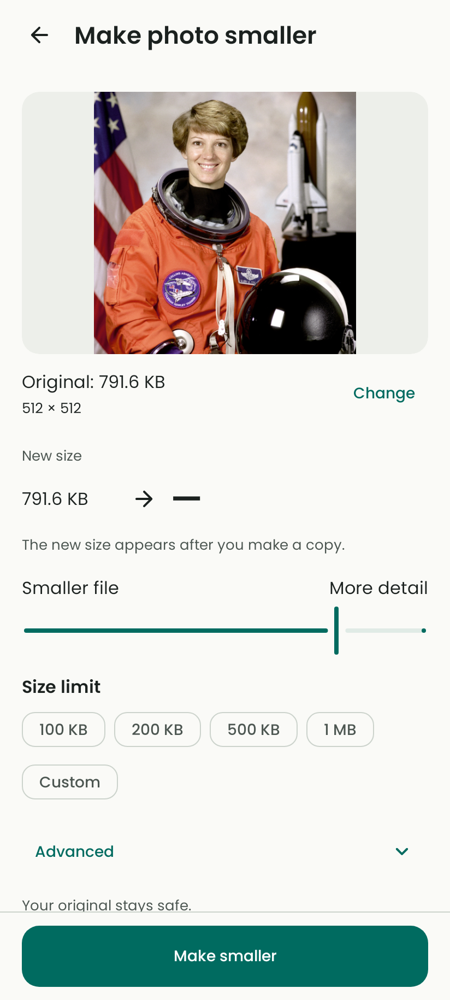

# Editor redesign — Step 1

Step 1 establishes the main screen's visual hierarchy, Poppins typography, and
presentation states for the [approved editor sequence](editor-plan.md). The
priority is a photo, its size, a clear adjustment, and one obvious next action.

**Scope:** the existing app now uses this layout through
`CompressionSettingsScreen`, with the real **Make smaller** button and existing
compression/results flow. Live estimates, automatic preparation, and same-screen
Save/Share are not connected to production yet. Those future states are rendered
and checked at the component boundary in this step.

## What changed

- A generous uncropped preview leads the screen, followed by the original size
  and quieter picture dimensions. Batch selections retain a photo-count label.
- The new size has the strongest typographic emphasis. **Smaller file** and
  **More detail** explain the slider without exposing an encoder-quality number.
- **Size limit** offers 100 KB, 200 KB, 500 KB, 1 MB, and Custom. Advanced options
  stay collapsed; existing format, resizing, and aspect-ratio controls remain
  available there. A custom draft is validated before preparation or export.
- Preview and controls sit side by side when there is enough usable space.
  Narrow windows stack them. Larger text wraps labels and stacks result/actions
  instead of reducing the user's font size.
- The screen can present loading, updating, verified, and failed states without
  inventing a byte count. A supplied retry action is prominent in the failed
  state. Originals remain untouched.

## Visual decisions

Poppins is bundled locally in Regular, Medium, and SemiBold. This avoids a font
network request and keeps text geometry consistent. See [font provenance and
licensing](fonts/README.md) for source revision, checksums, sizes, and the SIL Open
Font License packaged with the app.

| Role | Size / line height | Weight |
| --- | --- | --- |
| Screen title | 22sp / 28sp | SemiBold |
| Result size | 32sp / 40sp | SemiBold |
| Body and slider labels | 16sp / 24sp | Regular |
| Supporting information | 13sp / 20sp | Regular |
| Action labels | 14sp / 20sp | Medium |

The existing warm neutral surfaces and restrained teal theme are reused. The
fallback light palette uses `#FAFAF7` for the background, `#1B211F` for primary
text, and `#006B60` for actions. Dark mode uses `#101513`, `#E2E8E1`, and
`#82D5C4` respectively. Success colors communicate verified savings/fit; errors
use the error palette. Existing system/light/dark preferences and optional
Material You colors remain available.

The spacing scale stays 4, 8, 12, 16, 20, 24, and 32dp. Phone page insets are
20dp; wide layouts use 24dp insets and pane separation. Primary actions have a
56dp minimum visual height. Existing rounded vector icons retain consistent
alignment; decorative icons do not add redundant screen-reader labels. This is
not an app-wide icon replacement.

The phone photo frame is 240dp high. In a usable two-pane layout it expands with
the photo pane. Two panes require at least 840dp of available width and 480dp of
height; larger text raises the width threshold to 1080dp. Actions stay within
reach at the bottom of a tall phone window and move into the scrollable flow in
short or wide windows. These are available-window rules, not device-name rules.

## Presentation and truthful feedback

`PhotoEditorState` carries original information, settings, and an explicit
`EditorPreview` state. `PhotoEditorScreen` owns presentation and local entry/
disclosure drafts; it does not perform compression or storage work.

| State | What the component shows | Export behavior |
| --- | --- | --- |
| Not calculated | Original information, an uncalculated result, and an honest instruction to prepare it. | Production uses the real Make smaller action. |
| Loading | Matching preview/text placeholders and a loading message. | Preparation controls are disabled. |
| Updating | A labelled estimate if one is supplied, otherwise an updating message. A previous preview may remain visible for the same source. | Save/Share are disabled. |
| Ready | Measured result size and a fit/unmet message calculated from integer bytes. | Save/Share require a result matching the current source and settings and valid input. |
| Failure | A plain error and a retry action when provided by the caller. | No failed result can export. |

An invalid custom-size draft or invalid dimensions must not retain a green
“Fits” status from an older result. Changing settings or source also invalidates
the result's export eligibility. These presentation guards are useful now; the
future live session still needs cancellation, artifact lifetime checks, and
generation-aware result ownership.

Limits use decimal KB/MB. Fit decisions use actual bytes, not rounded size text.
An output above a selected limit must not be described as fitting even when its
rounded display matches the limit. The supplied component callbacks and fixtures
demonstrate these states; they are not evidence of a connected live estimator.

## Loading geometry and motion

`EditorPlaceholder(modifier, animate)` provides only the loading fill. Callers
supply the real content's dimensions and clipping, so the preview uses the same
frame and corner radius while loading. Text placeholders occupy the measured
text layout, with reserved result-width and status-height space.

The fill uses theme surfaces and a restrained moving highlight. It has no
artificial delay. Animation reads occur during drawing, avoiding layout work on
every frame. Placeholders are removed from accessibility semantics; the actual
loading message supplies the meaning. System/Compose disabled animations,
inspection mode, and `animate = false` use a static fill. Review renders disable
animation for deterministic captures. Device-level reduced-motion behavior still
belongs to the later accessibility check.

## Review captures

The primary review image is the [current app flow](screenshots/editor-current-flow.png):
the redesigned screen with the real **Make smaller** action used by the current
production adapter.



All captures here are native Android Compose/Canvas renders captured on the host
with Robolectric and real local image pixels. The additional captures below use
component test inputs to supply future result states. They are not physical-device
screenshots, connected live-processing demonstrations, or measurements of
photo-opening latency.

The licensed NASA astronaut PNG and a real JPEG encode supply the preview pixels
and measured file sizes (791.6 KB → 33.6 KB). Coil's memory cache is populated with
those real decoded pixels for deterministic rendering; this is not a cold-load
benchmark. The 320dp/200% text capture is scrolled to the result and slider. Phone
captures use 412 × 915dp and the dark tablet capture uses 1280 × 800dp.

| Capture | Review purpose |
| --- | --- |
| [Ready phone](screenshots/editor-ready-phone.png) | Main hierarchy and future verified Save/Share presentation. |
| [Dark tablet](screenshots/editor-tablet-dark.png) | Two panes and dark surfaces. |
| [Loading phone](screenshots/editor-loading-phone.png) | Preview/text geometry while content loads. |
| [Estimating phone](screenshots/editor-estimating-phone.png) | Explicit estimate label and disabled exports. |
| [Error phone](screenshots/editor-error-phone.png) | Retained original preview and a clear retry action. |
| [Large text](screenshots/editor-large-text.png) | Narrow layout at 200% text size, with stacked controls/actions. |

## Reuse and remaining work

The adapter keeps existing picker selection, settings persistence, dimension
validation, batch preparation, native compression, output storage, gallery
saving, sharing, and result comparison. The new screen reuses adaptive layout,
theme preferences, spacing, icons, and photo rendering components. Poppins is
applied through the shared typography system, so supporting screens also inherit
the font; their full redesign is Step 5.

Step 2 must measure the current photo-opening and Coil path before claiming an
improvement. Steps 3–4 must connect the temporary editing session and automatic
verified exports. A result render alone proves neither the speed of preparation
nor safe ownership of an output file. Device TalkBack, keyboard/IME behavior,
contrast, performance, and recovery remain production checks.

## Validation

Validation on 2026-10-30:

- The full host suite passed all **103 tests**, including 35 native Compose
  render/interaction tests (9 cover the new editor contract).
- `lintDebug` passed with **0 errors and 32 warnings**: 30 unused resources from
  the simplified screens and 2 dependency-update notices. Remove obsolete
  resources as supporting screens settle; dependency upgrades need their own
  compatibility checks. No warnings were suppressed.
- `assembleDebug` and `assembleDebugAndroidTest` passed. The debug APK contains
  all three Poppins fonts and the exact bundled OFL licence.
- The slider check caught Material's 44dp inner semantics region. A 48dp thumb
  layout preserves its slim visual appearance while meeting the target-size
  assertion. Large-text labels remain at their corresponding slider ends.
- Physical-device instrumentation, TalkBack traversal, and latency profiling
  were not run in this host environment. They remain separate release checks.

The editor checks cover native rendering, original metadata, loading geometry,
estimated-result restrictions, retry, large text, stale source/settings, exact
limit comparisons, and invalid custom entry. A focused run is:

```bash
bash gradlew testDebugUnitTest --tests 'com.example.imagecompressor.ui.design.PhotoEditorRenderTest'
```

Earlier
[validation records](../validation/README.md) describe earlier work and must not
be read as evidence that the new live editor or device performance has passed.
